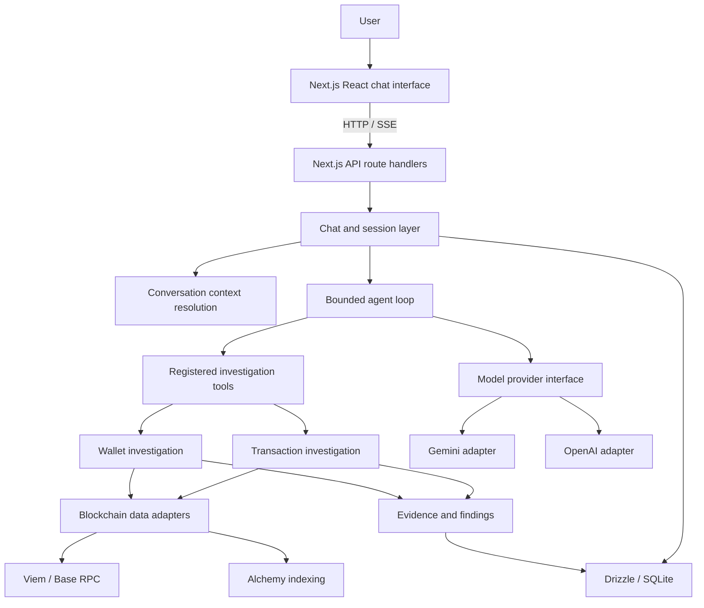

# Architecture

WDMWD is a **unified Next.js modular monolith**. The frontend, API route handlers, agent, provider adapters, and persistence layer are part of one application. A single Next.js process serves the chat interface and API.

This architecture keeps local installation and self-hosting simple while preserving internal module boundaries.

## System overview

## Main responsibilities

| Area | Responsibility |
|---|---|
| `src/app/` | Next.js application routes, layouts, pages, and API handlers. |
| `src/components/` | Chat, history, settings, activity, evidence, and shared UI components. |
| `src/hooks/` | Client-side interaction and state hooks. |
| `src/lib/` | Client utilities, formatting, and API integration. |
| `src/agent/` | Model-driven orchestration, registered tools, and agent instructions. |
| `src/model/` | Provider-independent model interface and model-specific adapters. |
| `src/chat/` | Session/message operations, conversation context, and SSE event formatting. |
| `src/wallet/` | Deterministic wallet investigation logic. |
| `src/transaction/` | Deterministic transaction inspection. |
| `src/data/` | RPC and indexed-data provider adapters. |
| `src/chain/` | Chain identifiers and supported-chain configuration. |
| `src/evidence/` | Evidence structures and helper functions. |
| `src/store/` | Drizzle schema, migrations, and database access. |
| `src/config/` | Environment parsing and runtime configuration. |
| `src/core/` | Shared types and core primitives. |

The precise file map can evolve. The responsibility boundaries above describe the current architecture reported for V1.

## Request lifecycle

### Chat request

1. The browser sends a message to `POST /api/chat`.
2. The route validates the request and resolves or creates the conversation session.
3. Conversation context resolution identifies relevant wallet addresses and transaction hashes from the current message and prior turns.
4. The chat layer begins an SSE response and emits user-facing lifecycle events.
5. The bounded agent loop asks the configured model which registered investigation tool is needed.
6. The backend validates tool arguments and executes the relevant deterministic tool.
7. Tool results and evidence references are made available to the agent and emitted through the documented event stream.
8. The agent composes a response grounded in the retrieved results and evidence.
9. The chat layer persists the completed messages and relevant investigation state.
10. The stream ends with the completion and termination events described in the API reference.

The stream communicates progress, tool activity, evidence identifiers, and user-facing answer text. Private model chain-of-thought is not part of the public API.

## Agent loop

The agent is a custom tool-calling loop rather than an unrestricted autonomous process. The reported defaults are:

| Limit | Default |
|---|---:|
| Maximum tool calls per request | `8` |
| Maximum agent iterations | `6` |
| Request timeout | `60000` ms |

The implementation validates tool names and arguments and stops when configured limits are reached. These controls are important for preventing runaway loops and unbounded provider usage.

The V1 registered investigation capabilities include:

- `wallet`: wallet profile, supported transfer activity, counterparties, and interacted contracts.
- `transaction`: transaction status, sender/recipient details, ETH value and gas information, contract-versus-EOA classification, and event-log information available to the implementation.

Multi-hop tracing, wallet relationship analysis, and pattern detection are not implemented in V1.

## Model provider abstraction

The agent depends on a provider-independent model interface in `src/model/`. Provider-specific request and response handling lives in the corresponding adapters. The reported adapters are Gemini and OpenAI.

The selected provider and credentials are configured through environment variables. Provider keys must remain server-side and must never be returned to the browser or written into logs.

## Blockchain data flow

V1 targets Base Mainnet (`chainId: 8453`). Viem is used for RPC operations, while Alchemy provides indexed/historical activity. Provider adapters translate external responses into application-level data structures.

Amounts are preserved using integer arithmetic. Alchemy's floating-point `value` field is not used for exact token amounts; raw contract hex values are converted to `BigInt` and represented as exact decimal strings before formatting.

See [Blockchain Data](blockchain.md) for provider roles and current coverage limits.

## Evidence and findings

Investigation tools return structured findings and evidence. Findings include a classification, evidence identifiers, and limitations. Evidence records retain references such as transaction hashes, block numbers, involved addresses, source, and retrieval time when available.

The agent distinguishes confirmed information, inferred interpretations, and unknowns. It must not turn an inference into a confirmed claim or imply that incomplete provider coverage proves an event did not happen.

See [Evidence Model](evidence.md).

## Persistence

SQLite is the local persistence layer, accessed through Drizzle ORM and `better-sqlite3`.

The reported schema contains:

- `sessions`
- `messages`
- `investigations`
- `evidence`
- `entities`
- `settings`

Conversation history and settings persist across application restarts. Session deletion uses database cascade relationships for dependent records configured by the schema.

Database migrations are generated and applied through the repository scripts during local development. Docker startup applies pending migrations through the Node instrumentation startup path.

## Frontend architecture

The frontend is not a separate deployment. It is part of the Next.js application and communicates with route handlers on the same origin.

The interface is chat-first and includes:

- Message composer and conversation stream.
- Streaming response rendering.
- Collapsible investigation activity.
- Collapsible evidence sources.
- Conversation history controls.
- Settings controls for supported UI preferences.
- Responsive desktop and mobile layouts.

The visual system uses a dark interface, Space Grotesk and Inter typography, and blue/lime accents. Backend changes should preserve the established frontend design and interactions.

## Operational boundaries

- One local/self-hosted installation is intended for one user.
- Base Mainnet is the only configured network in V1.
- The application is read-only and does not sign or submit transactions.
- Local model execution is not implemented in V1.
- Remote access is not equivalent to authentication; operators must add an external access-control layer before exposing an instance remotely.
